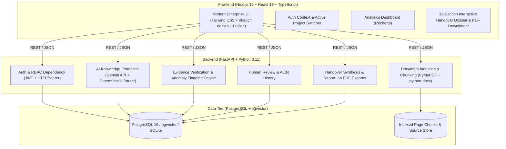

# KNOWLEDGE CONTINUITY
### Team: Web_hunter
**Evidence-Linked Project Knowledge Handover Platform**

---

## 1. Executive Summary

When critical team members leave an organization, irreplaceable tribal knowledge, architectural decisions, unfinished tasks, and risk contexts evaporate with them.

**Knowledge Continuity** is a production-quality, full-stack enterprise platform that ingests authorized project documentation (PDF, DOCX, TXT), reconstructs the project state, verifies every single finding against exact source page quotations, flags conflicting dates and ambiguous ownership, allows managerial review, and synthesizes an official 13-section handover package for incoming engineers—complete with PDF export and backend-enforced RBAC.

---

## 2. Architecture & Tech Stack



| Layer | Technologies |
|---|---|
| **Frontend** | Next.js 15 (App Router), React 19, TypeScript, Tailwind CSS, Lucide Icons, Recharts, clsx |
| **Backend** | Python 3.11, FastAPI, Pydantic v2, SQLAlchemy 2.0, Alembic, Passlib (bcrypt), PyJWT |
| **Document Processing** | PyMuPDF (`fitz`), `python-docx`, UTF-8 chunker preserving page numbers and word boundaries |
| **AI Engine** | Google Gemini API (`gemini-1.5-flash` / `gemini-1.5-pro`) with structured JSON schema output + deterministic zero-hallucination NLP regex/heuristic fallback |
| **Evidence Engine** | Bidirectional quote matching, string alignment scoring, contradiction detection, and ambiguous ownership flagger |
| **PDF Generation** | ReportLab 5.1 (Enterprise styling, tables, evidence citations, sign-off banners) |
| **Database** | PostgreSQL 16 with pgvector extension / SQLite fallback |

---

## 3. Platform Modules

### A. Authentication & Backend-Enforced RBAC
- Passwords hashed using `bcrypt` (12 rounds).
- JWT access tokens with 24-hour expiration.
- FastAPI dependency `check_project_access` checks roles on every protected endpoint.
- **Roles:**
  - `ADMIN`: Full access to all projects, documents, reviews, and platform settings.
  - `PROJECT_MANAGER`: Full management, review workspace, sign-offs, and handover generation.
  - `OUTGOING_MEMBER`: Uploads source documents, contributes project context, reviews evidence.
  - `INCOMING_MEMBER`: Viewing restricted strictly to **manager-approved** handovers and verified evidence. Unapproved drafts and internal review queues are rejected with `403 Forbidden`.

### B. Source Ingestion & Page-Level Chunking
- Supports **PDF**, **DOCX**, and **TXT** files.
- Drag-and-drop multi-file upload with 25MB validation.
- SHA-256 deduplication to prevent redundant indexing.
- Page preservation: every chunk strictly records its `page_number`, `chunk_index`, and character offsets.

### C. AI Knowledge Extraction (10 Entity Types)
Extracts structured facts strictly backed by citations:
1. `DECISION`: Architectural and organizational choices.
2. `TASK`: Concrete engineering action items.
3. `RESPONSIBILITY`: Explicit role assignments.
4. `DEADLINE`: Dates and target delivery quarters.
5. `MILESTONE`: High-level release targets.
6. `RISK`: Technical debt, single points of failure, scalability bottlenecks.
7. `BLOCKER`: Active impediments requiring escalation.
8. `DEPENDENCY`: Third-party APIs, vendor couplings, upstream services.
9. `QUESTION`: Unresolved architectural questions or open RFCs.
10. `CONTACT`: Domain leads, DevOps admins, and points of contact.

> **Zero-Hallucination Guarantee**: If an owner or deadline is not explicitly identified in the source quote, it is marked as `null`. No facts are invented. Recommendations are explicitly separated from facts via `is_recommendation: bool`.

### D. Evidence Verification & Contradiction Detection
- **Quote Verification**: Matches `supporting_quotation` against the indexed page chunk text using exact substring and SequenceMatcher token overlap.
- **Conflict Detection**: Compares findings across documents. If Document A specifies *"Deadline May 20"* while Document B specifies *"Deadline May 30"*, both findings are flagged with `has_conflict: true` and `verification_status: CONFLICTING`.
- **Ambiguous Ownership**: Detects unclear ownership (e.g. multiple people or unresolved TBDs).

### E. Human Review & Managerial Sign-Off
- Dedicated review queue for Project Managers and Admins.
- Inspect findings, edit descriptions, adjust owners/deadlines, and approve or reject.
- Flag for investigation with reviewer notes.
- Audit history preserved in `reviews` table.

### F. Handover Dossier & PDF Export
Synthesizes the complete 13 required sections:
1. Project Overview
2. Current Project Status
3. Completed Work
4. Pending Tasks & Deadlines
5. Task Ownership Matrix
6. Architectural Decisions Record (ADR)
7. System Dependencies
8. Active Blockers
9. Risk Register & Mitigations
10. Unresolved Questions
11. Recommended Next Actions (Day 1, Week 1, Month 1)
12. Evidence Traceability Audit Table
13. Managerial Review & Sign-Off Block

---

## 4. Quick Start Guide

### Prerequisites
- Python 3.11+
- Node.js 18+ and npm
- (Optional) Docker & Docker Compose

### Option 1: One-Click Launch (Windows PowerShell)

```powershell
# Run the automated launch script:
.\start_all.ps1
```
*Or via Command Prompt:*
```cmd
start_all.bat
```

### Option 2: Manual Step-by-Step

#### 1. Backend Setup
```powershell
# Navigate to project root
cd d:\sfsaf\codeinpune

# Activate Python virtual environment
backend\venv\Scripts\activate

# Set python path
$env:PYTHONPATH = "."

# Seed the database with users, Apollo project, and verified findings
python backend\seed_data.py

# Start FastAPI backend
python -m uvicorn backend.app.main:app --host 127.0.0.1 --port 8000 --reload
```
API Documentation will be live at: **http://127.0.0.1:8000/docs**

#### 2. Frontend Setup
```powershell
# Open a second terminal and navigate to frontend
cd frontend

# Start Next.js development server
npm run dev
```
Application interface will be live at: **http://localhost:3000**

### Option 3: Docker Compose
```bash
docker-compose up --build
```

---

## 5. Demo Accounts

All demo accounts use password: `Password123!`

| Role | Email | Purpose |
|---|---|---|
| **ADMIN** | `admin@knowledgecontinuity.io` | Full system administration and audit inspection |
| **PROJECT_MANAGER** | `pm@knowledgecontinuity.io` | Review workspace, edit findings, approve handovers |
| **OUTGOING_MEMBER** | `outgoing@knowledgecontinuity.io` | Uploads architecture documents and sprint logs |
| **INCOMING_MEMBER** | `incoming@knowledgecontinuity.io` | Views approved handover report & onboarding plan |

> **Interactive Role Tester**: Use the role buttons in the sidebar footer to switch roles with a single click and test backend permission boundaries immediately!

---

## 6. End-to-End Workflow Verification

| Step | Action | Backend Verification | Frontend View |
|---|---|---|---|
| 1 | Register / Login | `POST /api/auth/login` | Login / Auth Provider |
| 2 | Create Project | `POST /api/projects` | Projects Modal / Switcher |
| 3 | Add Project Members | `POST /api/projects/{id}/members` | Team & Permissions View |
| 4 | Upload Documents | `POST /api/documents/{id}/upload` | Sources View (Dropzone) |
| 5 | Text & Chunk Extraction | PyMuPDF & python-docx parser | Chunk Inspector Drawer |
| 6 | AI Knowledge Extraction | Gemini API / Deterministic NLP | Knowledge Base Explorer |
| 7 | Evidence Verification | SequenceMatcher quote matching | Evidence Modal Inspector |
| 8 | Conflict Detection | Flags contradictory deadlines | Conflicting tag in Knowledge |
| 9 | Human Review & Edit | `POST /api/review/{id}/findings/{f_id}` | Review Workspace Queue |
| 10 | Manager Sign-Off | Status updated to `APPROVED` | Approval Badge & Audit Log |
| 11 | Handover Generation | `POST /api/handovers/{id}/generate` | Handover Dossier (13 Sections) |
| 12 | PDF Export | `GET /api/handovers/{id}/{h_id}/export-pdf` | ReportLab PDF Download |
| 13 | Incoming Member View | Role-enforced filtered access | Handover Reader (Redacted Drafts) |

---

## 7. Team Details

- **Project**: Knowledge Continuity
- **Team**: Web_hunter
- **Event**: Hackathon 2026
